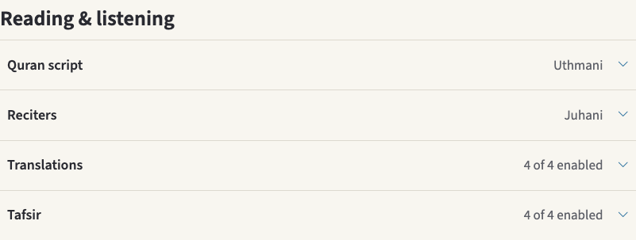
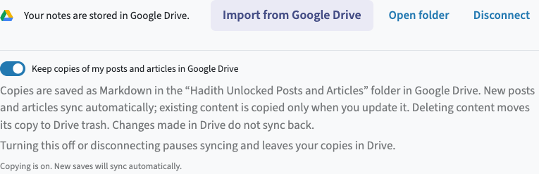

# Account, sign-in and preferences

Both Settings routes group reading, memorization, storage and account preferences into expandable rows.

## Using the feature

| Function | What the reader sees and does | How it works |
| --- | --- | --- |
| Sign in or out | The account menu changes from sign-in to identity and account actions. Personal panels can show loading, signed-out or saved states. | The login API verifies Google credentials, issues the site session and supports session lookup and logout. Privileged controls also depend on administrator access and edit mode. |
| Find a setting | The category rail and filter sit on the right at 992 px and up. On a phone the filter precedes the panels. Opening a disclosure reveals controls beneath its label. | Groups and row keys drive the navigation. Fragment links open a specific section and preserve its return location across Settings and Quran Settings. |
| Choose reading defaults | Three script samples display Uthmani, Indo-Pak and Warsh. Reciters, translations and tafsirs have their own lists, selection controls and ordering where supported. | The client loads saved choices and the relevant catalogs. IDs select a script, reciter or work across reader sessions. An explicit work URL can still open a particular translation. |
| Tune review | Review sessions exposes timing and limits. Advanced settings disclose category caps, ordering and spaced repetition choices. | Validated preferences affect regular session construction. Custom passage or page review follows its selected scope. |
| Set note appearance and storage | Theme samples set the default note background. Drive actions depend on connection state. A separate switch keeps copies of Community posts and articles. | The notebook connection owns note storage. Optional Community copies sync outward on updates. Disconnecting or switching off copies pauses that sync and leaves existing files in Drive. |
| Manage email and billing | Email preferences opens a dedicated page and returns to its originating Settings row. The points panel appears when payments are enabled. | The page passes its origin through the email link. The payment feature flag and authenticated summary determine billing availability and displayed balance. |

## Recognizing a saved preference

Selecting a script sample is an immediate save. On a failed request the client restores the prior selected radio button and reports the failure beside the script options. Retrying successfully leaves the new sample selected. Opening the other Settings route reads the same account preference. The repository’s personal browser fixture exercises this sequence with Indo-Pak.

The payments panel has a different interaction. Changing the auto-recharge threshold or package prepares a value for **Save**. **Buy** begins a separate checkout immediately. The status beside each group identifies which action completed. [Personal workflow fixture](../../../spec/browser/personal-regression.cjs)

## Following a request

Opening /quran/settings and selecting Email preferences carries the Quran Settings return path. Returning opens the original disclosure. For catalog changes, inspect the status beside the control that initiated the change. Some sections act immediately while others provide an explicit save action.

## Visual reference

Settings rows with summaries and disclosure controls.

Connected and conditional Drive actions in the storage section.

## Earlier desktop and phone captures

These links open the archived route atlas. The URL identifies the original capture, including any redirect or gated state it encountered.

| Screen | Requested URL | Desktop | Phone |
| --- | --- | --- |
| Settings | `/settings` | [Wide](../../design-system/screens/settings-wide.jpg) | [Narrow](../../design-system/screens/settings-small.jpg) |

## Implementation and related reading

- Groups, controls, validation and status handling. [views/settings.ejs](../../../views/settings.ejs)
- Standard and Quran variants. [routes/settings.js](../../../routes/settings.js)
- Sign-in, session lookup and logout. [routes/login.js](../../../routes/login.js)
- Authenticated settings reads and writes. [routes/userSettings.js](../../../routes/userSettings.js)
- Stored preferences. [lib/UserSettings.js](../../../lib/UserSettings.js)
- Filtering and section navigation. [public/static/js/settings-filter.js](../../../public/static/js/settings-filter.js)

Related guides · [Email subscriptions and in-app alerts](../notifications/README.md) · [Points, billing and on-demand translation](../billing-and-translation/README.md) · [Notebook, editing, sharing and export](../notebook/README.md)

[All features](../README.md)
