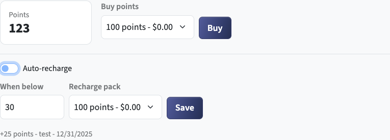

# Points, billing and on-demand translation

When enabled, a reader can request translation of a supported content item and manage the points used by the service.

## Using the feature

| Function | What the reader sees and does | How it works |
| --- | --- | --- |
| Check availability and estimate | The item translation control offers available languages and an estimate before a new translation is requested. | The service identifies the item type, item ID, target language and mode. It checks existing content and estimates the cost from the source fields, configured rate and minimum. |
| Request content | The result appears in the translation workflow. Missing access, disabled service and insufficient points have different outcomes. | The API checks feature configuration, authentication and any admin-only restriction. Insufficient points returns 402. A completed request returns the updated balance. A cached result follows a separate path from newly charged work. |
| Buy points | Settings shows balance, package selector and Buy. Manage payments opens the billing portal. Auto-recharge groups its threshold and package beside Save. | Checkout creation associates a package and return path with the verified account. A translation-specific checkout also binds the item and language. The return endpoint reconciles the session for its owner. |
| Fulfill or cancel | After returning from checkout, the balance and recent activity can refresh. An unfinished translation checkout can be canceled. | The server verifies payment events and processes completed sessions or successful payment intents. The summary loads balance, profile and the ten most recent ledger entries. |

## Following a request

A reader who needs a translation first requests an estimate for that item. If checkout is needed, the item reference travels with the payment session so the return flow can resume the correct task. The old public translation request queue and its feeds return 410. Published Quran translations remain accessible through the translation library.

## Visual reference

Billing panel showing the balance, purchase action and separate auto-recharge settings. Amounts in the specimen are fixture values.

## Implementation and related reading

- Availability, access, estimates and results. [routes/contentTranslations.js](../../../routes/contentTranslations.js)
- Content selection, points and stored results. [lib/ContentTranslations.js](../../../lib/ContentTranslations.js)
- Checkout, portal, summary and event handling. [routes/payments.js](../../../routes/payments.js)
- Balances and ledger. [lib/UserPoints.js](../../../lib/UserPoints.js)
- Session reconciliation and fulfillment. [lib/Payments.js](../../../lib/Payments.js)
- Billing controls. [views/settings.ejs](../../../views/settings.ejs)

[All features](../README.md)
