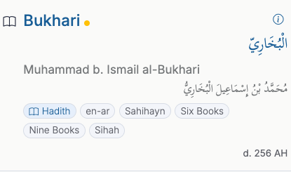

# Book catalogs and metadata

Use /books to choose a work across Hadith, History and Sirah, Sharḥ, translations, tafsir and Mushaf editions.

## Using the feature

| Function | What the reader sees and does | How it works |
| --- | --- | --- |
| Switch collections | Desktop shows collection tabs. A compact selector serves narrow layouts. Each collection can show a highlighted shelf followed by grouped bilingual directory rows. | Query flags such as `?tafsir` or `?mushaf` select the collection. The route combines visible library books with separate translation, tafsir, Sharḥ and Mushaf catalogs. |
| Narrow the directory | Search appears in the desktop rail and above the groups on phones. Applied classifications have removable pills. Highlights give way to the filtered list. | The catalog client handles the view and matches the available entries. The language badge uses indexed English-body coverage with a SQL fallback for physical books. Virtual coverage uses resolved snapshot rows. |
| Inspect a book | A row aligns the English and Arabic book titles and places the short author name and dates below. The info button opens details with classifications and a scrollable description. | The row opens the work. In the dialog a classification applies a filter and Open book navigates to the selected work. Each book family supplies its own destination. |
| Load the catalog | The plain public catalog can appear immediately from cached HTML. An editor sees authorized controls in its rendered version. | The route tests the query, flush state and edit mode before using disk HTML. It indexes dependencies on book aliases and commentary catalogs for invalidation. |

## Following a request

For a tafsir lookup, select Tafsir, narrow by language or title, inspect the metadata, then activate Open book. The result is a commentary work with its own contents and passage links. The same sequence on the Mushaf tab selects a printed edition.

## Visual reference

Directory row with bilingual titles, author metadata and a separate information action.

## Earlier desktop and phone captures

These links open the archived route atlas. The URL identifies the original capture, including any redirect or gated state it encountered.

| Screen | Requested URL | Desktop | Phone |
| --- | --- | --- |
| Hadith catalog | `/books` | [Wide](../../design-system/screens/library-wide.jpg) | [Narrow](../../design-system/screens/library-small.jpg) |
| History catalog | `/books?history` | [Wide](../../design-system/screens/history-wide.jpg) | [Narrow](../../design-system/screens/history-small.jpg) |
| Sharh catalog | `/books?sharh` | [Wide](../../design-system/screens/sharh-list-wide.jpg) | [Narrow](../../design-system/screens/sharh-list-small.jpg) |
| Translation catalog | `/books?translation` | [Wide](../../design-system/screens/translations-wide.jpg) | [Narrow](../../design-system/screens/translations-small.jpg) |
| Tafsir catalog | `/books?tafsir` | [Wide](../../design-system/screens/tafsirs-wide.jpg) | [Narrow](../../design-system/screens/tafsirs-small.jpg) |
| Mushaf catalog | `/books?mushaf` | [Wide](../../design-system/screens/mushafs-wide.jpg) | [Narrow](../../design-system/screens/mushafs-small.jpg) |

## Implementation and related reading

- Catalog data, badge queries, caching and download formats. [routes/books.js](../../../routes/books.js)
- Collection sections and rows. [views/books.ejs](../../../views/books.ejs)
- Filters, selections and book details. [public/static/js/book-catalog.js](../../../public/static/js/book-catalog.js)
- Edition catalog. [lib/QuranMushafBooks.js](../../../lib/QuranMushafBooks.js)
- Classification and grouping. [lib/BookGroups.js](../../../lib/BookGroups.js)

Related guides · [Hadith contents, reading and source detail](../hadith-reader/README.md) · [History and Sirah](../sirah-history/README.md) · [Sharḥ collections and explanations](../sharh/README.md) · [Quran translation library and comparison](../quran-translations/README.md) · [Tafsir library and passage reading](../tafsir/README.md) · [Mushaf pages and facing-page reading](../mushaf/README.md)

[All features](../README.md)
