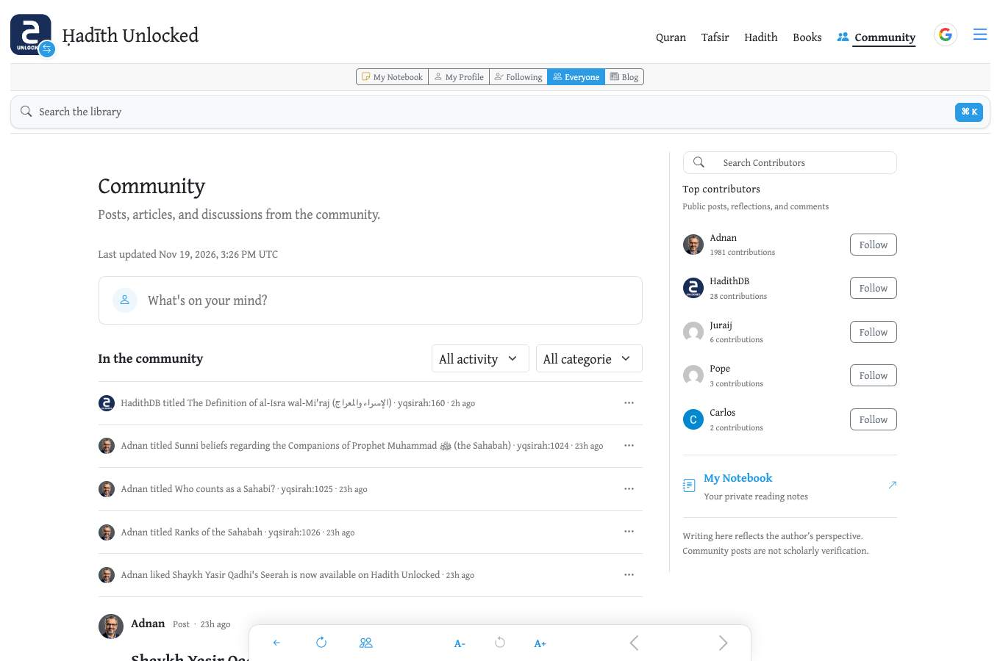

# Community feeds, profiles and interactions

Community gathers published writing and activity into Everyone, Following and personal views. Visibility depends on both the source and the viewer.

## Using the feature

| Function | What the reader sees and does | How it works |
| --- | --- | --- |
| Read a feed | Activity and category selectors sit beside the feed title and wrap below it on small screens. Cards identify the author, source, excerpt and actions. | The first Everyone page is rendered with feed data. The feed API takes filters and viewer context for later results. Following and Mine load account-specific activity. |
| Find a contributor | The contributor search opens a people dialog. Profile pages show author information and eligible writing. Follow controls reflect the signed-in relationship. | The API resolves handles and checks profile visibility. A private profile restricts the profile view while published posts and comments can remain visible in Community. |
| React and discuss | Cards can expose likes, votes, reposts, replies and sharing. Opening discussion reveals the conversation and reply context. | Interaction APIs identify both source type and ID. Reactions and replies attach to that target. Source visibility is applied when retrieving discussion and activity. |
| Read alerts | Unread alerts sit beside Following in the wide navigation and appear in the compact phone selector. | The client requests unread alerts for the signed-in reader and marks a read boundary. Following and email subscription preferences have distinct delivery effects. |
| Report or moderate | Eligible posts expose a report action. Moderators can inspect the queue and act on a publication. | Reports and moderation have separate endpoints and account checks. With moderation disabled the moderation page redirects to Mine. |

## Following a request

Follow an author, then use Following to read their activity. Opening a post takes you to its stable post address. An author can later change their handle or profile visibility, so the visible author label and the post’s permanent identity serve different purposes.

## Earlier desktop and phone captures

These links open the archived route atlas. The URL identifies the original capture, including any redirect or gated state it encountered.

**Community feed with activity filters and cards in the archived layout**

| Desktop | Phone |
| --- | --- |
|  |  |

| Screen | Requested URL | Desktop | Phone |
| --- | --- | --- |
| Community feed | `/community` | [Wide](../../design-system/screens/community-wide.jpg) | [Narrow](../../design-system/screens/community-small.jpg) |
| Community article feed | `/community?filter=article` | [Wide](../../design-system/screens/community-article-wide.jpg) | [Narrow](../../design-system/screens/community-article-small.jpg) |
| Following · signed out | `/community/following` | [Wide](../../design-system/screens/following-wide.jpg) | [Narrow](../../design-system/screens/following-small.jpg) |
| My profile · signed out | `/community/mine` | [Wide](../../design-system/screens/mine-wide.jpg) | [Narrow](../../design-system/screens/mine-small.jpg) |
| Contributor profile · signed out | `/community/@hadithunlocked` | [Wide](../../design-system/screens/profile-wide.jpg) | [Narrow](../../design-system/screens/profile-small.jpg) |
| Moderation entry redirect | `/community/moderation` | [Wide](../../design-system/screens/moderation-wide.jpg) | [Narrow](../../design-system/screens/moderation-small.jpg) |

## Implementation and related reading

- Page, feed, profile, relationship, reaction and moderation routes. [routes/community.js](../../../routes/community.js)
- Feed, profile and account views. [views/community.ejs](../../../views/community.ejs)
- Indexed activity. [lib/CommunityActivityIndex.js](../../../lib/CommunityActivityIndex.js)
- Per-source visibility. [lib/CommunityVisibility.js](../../../lib/CommunityVisibility.js)
- Discussion and reactions. [lib/CommunityInteractions.js](../../../lib/CommunityInteractions.js)
- Index coverage and refresh behavior. [docs/community-substack/activity-index.md](../../../docs/community-substack/activity-index.md)

Related guides · [Community writing, articles and blog](../publishing/README.md) · [Reader reflections and replies](../reflections/README.md) · [Email subscriptions and in-app alerts](../notifications/README.md) · [ActivityPub federation](../federation/README.md)

[All features](../README.md)
