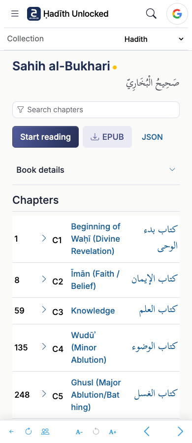
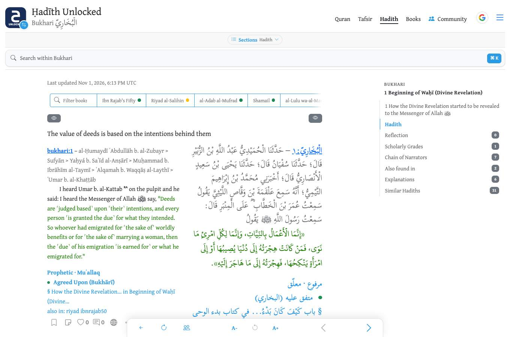
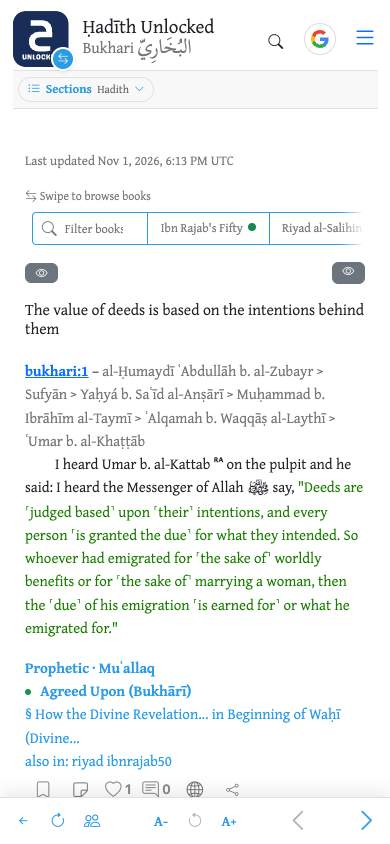

# Hadith contents, reading and source detail

A book hierarchy and a numbered report are separate ways to reach a narration. The section preserves reading order. The individual report exposes its source evidence.

## Using the feature

| Function | What the reader sees and does | How it works |
| --- | --- | --- |
| Browse contents | The bilingual book heading precedes details, introduction and chapter rows. Sections and subheadings nest below the chapter. A side index supports long works. | The book alias resolves the work. Chapter and section numbers select its headings. A chapter can redirect to its first readable section, as with /bukhari/1. |
| Read a section | English and Arabic narration, headings and breadcrumbs locate each item. The compact book switcher belongs to the browsing context. | The section handler resolves headings and retrieves the corresponding records in reader order. Continued sections keep their own breadcrumb targets. |
| Inspect a report | The circled info beside the English reference or in its footer opens the individual report. The reference and available title precede language and metadata controls. | The colon URL resolves a book and report number. The detail template composes the report, metadata, links, grades and available explanations for that record. |
| Trace evidence | Depending on the record, the reader can inspect chains and narrators, grader opinions, related reports, parallel references and attached Sharḥ. | Grade lookup reads stored opinions. Related references identify their collection and number. Sharḥ rows lead to the relevant source entry. Sparse records expose fewer panels. |
| Read a virtual collection | The reader presents the virtual book’s reference and ordering with the underlying narration. | The virtual mapping resolves source records while preserving the virtual number for browsing. Edits to membership and edits to source content have different owners. |
| Read an introduction | An authored introduction opens from the contents. Its bilingual book heading links back to that book. | Introduction sections have their own renderer. A book can have contents without authored introductory text. |

## Reading the evidence panels

| Panel | How to read it |
| --- | --- |
| Scholarly Grades | Read the grade together with its grader. Multiple opinions can coexist for a report. A grade on one report should not be carried over to a linked report. |
| Chain of Narrators | The ordered Arabic list preserves transmission order. Reliability, flags and death information appear when present. Investigate the named person in the chain before attributing a judgment to the whole narration. |
| Also found in | A virtual collection link opens its own book and number. The chapter and section below give the placement within that collection. |
| Explanations | An attached entry identifies a Sharḥ source. Expand the explanation or follow the work to read it in context. |
| Definitions | Expand a matched Arabic term to read its available lexical material. A definition belongs to a word in the report. |
| Similar Hadiths | The reference index and related narrations let the reader compare wording across records. Each related report has its own identity and metadata. |

English and Arabic metadata headings share a row on a wide screen and stack within the reading column on a phone. Where a record has no entries for a panel, the public view can omit it. Edit mode can still expose that section so a contributor can add material.

## Following a request

From /bukhari open chapter 1 and its first section. Use the English info action on report 1 to reach /bukhari:1. Follow a linked explanation to read a named scholar’s text. Keep the Bukhari reference when citing the narration and the Sharḥ work and entry when citing the explanation.

## Visual reference

Book contents at phone width, with hierarchy retained in the main column.

## Earlier desktop and phone captures

These links open the archived route atlas. The URL identifies the original capture, including any redirect or gated state it encountered.

**Individual report with bilingual text and a linked reference in the archived layout**

| Desktop | Phone |
| --- | --- |
|  |  |

| Screen | Requested URL | Desktop | Phone |
| --- | --- | --- |
| Hadith collection contents | `/bukhari` | [Wide](../../design-system/screens/collection-wide.jpg) | [Narrow](../../design-system/screens/collection-small.jpg) |
| Authored book introduction | `/adab/introduction` | [Wide](../../design-system/screens/book-intro-wide.jpg) | [Narrow](../../design-system/screens/book-intro-small.jpg) |
| Chapter entry redirect | `/bukhari/1` | [Wide](../../design-system/screens/chapter-wide.jpg) | [Narrow](../../design-system/screens/chapter-small.jpg) |
| Chapter entry · Book of Faith | `/bukhari/2` | [Wide](../../design-system/screens/hadith-chapter-wide.jpg) | [Narrow](../../design-system/screens/hadith-chapter-small.jpg) |
| Hadith section | `/bukhari/1/1` | [Wide](../../design-system/screens/section-wide.jpg) | [Narrow](../../design-system/screens/section-small.jpg) |
| Hadith subsection entry | `/bukhari/65/2/1` | [Wide](../../design-system/screens/subsection-wide.jpg) | [Narrow](../../design-system/screens/subsection-small.jpg) |
| Individual hadith | `/bukhari:1` | [Wide](../../design-system/screens/hadith-wide.jpg) | [Narrow](../../design-system/screens/hadith-small.jpg) |

## Implementation and related reading

- Book, chapter, section, introduction and report handlers. [routes/search.js](../../../routes/search.js)
- Shared report component. [views/sub-views/hadith.ejs](../../../views/sub-views/hadith.ejs)
- Detail panels and relationships. [views/sub-views/hadith_metadata.ejs](../../../views/sub-views/hadith_metadata.ejs)
- Grader lookup. [lib/HadithGradeLookup.js](../../../lib/HadithGradeLookup.js)
- Virtual numbering and source resolution. [lib/VirtualHadithReader.js](../../../lib/VirtualHadithReader.js)
- Introductory reading sections. [lib/HadithIntroductionSections.js](../../../lib/HadithIntroductionSections.js)

Related guides · [Sharḥ collections and explanations](../sharh/README.md) · [Sharing, image cards and printing](../sharing-and-printing/README.md) · [Administration and inline editing](../editorial-admin/README.md)

[All features](../README.md)
