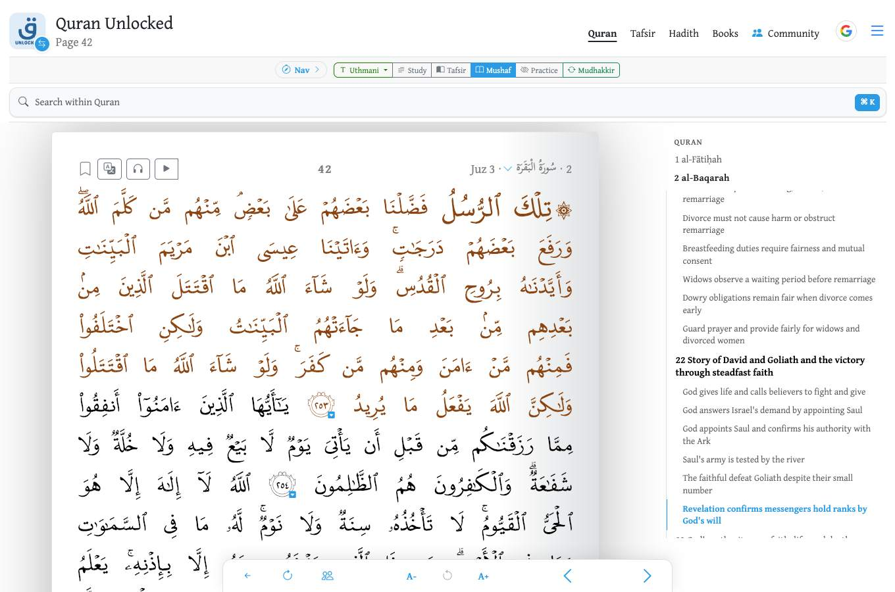
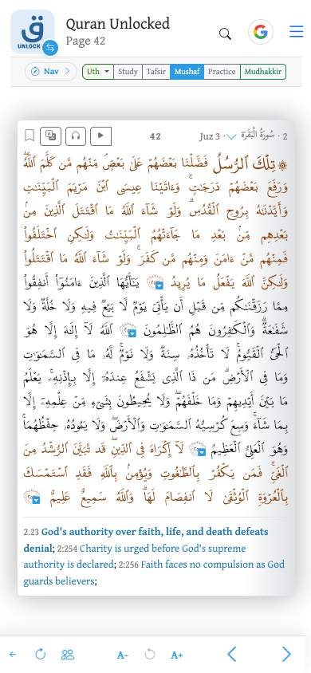

# Mushaf pages and facing-page reading

The Mushaf uses the printed page as the navigation unit. Selecting a word or ayah adds context while keeping the page layout intact.

## Using the feature

| Function | What the reader sees and does | How it works |
| --- | --- | --- |
| Open a leaf | The page shows a surah header, Arabic lines, ayah markers, surah frames and a page number. The header gives access to contents, bookmark and book view. | /quran/page/:page resolves pages 1–604. Script selection changes the edition’s rendering. The reference-to-page mapping carries an ayah from Study into the Mushaf. |
| Select and listen | A tapped ayah selects its translation. Word meanings are available individually. Play starts from the selection and the marquee follows recitation. | Audio timing segments identify the active ayah. Selection and playback update the active leaf and turn the spread when playback reaches its boundary. |
| Open facing pages | The book icon opens the spread with odd page on the right, even on the left and shared audio and translation controls on the left leaf. Titles, margins and printed lines scale together. | The spread is available above 600 CSS pixels, except short touch-first landscape layouts. Closing or shrinking to phone layout restores the exact current reading page, including an even page. |
| Turn or jump | Swipe or drag right to advance and left to go back. The slider previews page and juz during a drag. Page number opens navigation. Search can jump to an ayah within the book. | Slider release commits the target. Adjacent spreads are prepared in advance. Reduced motion affects the turn animation. Escape restores the regular reader. |
| Preserve printed divisions | A surah frame and its basmallah occupy distinct printed rows. Section links sit beside the paper on wide layouts and below the text on narrow ones. | Layout follows the edition’s row data. A frame in the final row stays there even when the basmallah falls on the next page. |

## Following a request

From /quran/page/42 select an ayah, open facing pages and move to its neighboring leaf. Use the translation or audio control, then close the spread. The page returned to the regular reader follows the active reading position. Page practice uses the same printed location with additional concealment controls.

## Earlier desktop and phone captures

These links open the archived route atlas. The URL identifies the original capture, including any redirect or gated state it encountered.

**Printed Arabic page with the selected translation below in the archived layout**

| Desktop | Phone |
| --- | --- |
|  |  |

| Screen | Requested URL | Desktop | Phone |
| --- | --- | --- |
| Mushaf page | `/quran/page/42` | [Wide](../../design-system/screens/mushaf-wide.jpg) | [Narrow](../../design-system/screens/mushaf-small.jpg) |
| Indo-Pak script | `/quran/page/1?script=indo-pak` | [Wide](../../design-system/screens/indopak-wide.jpg) | [Narrow](../../design-system/screens/indopak-small.jpg) |
| Warsh script | `/quran/page/1?script=warsh` | [Wide](../../design-system/screens/warsh-wide.jpg) | [Narrow](../../design-system/screens/warsh-small.jpg) |

## Implementation and related reading

- Printed reader, shell and Practice variants. [views/quran_mushaf.ejs](../../../views/quran_mushaf.ejs)
- Spread layout, selection, controls and page turns. [public/static/js/mushaf-book.js](../../../public/static/js/mushaf-book.js)
- Page and reference mappings. [lib/QuranMushaf.js](../../../lib/QuranMushaf.js)
- Script variants. [lib/QuranScripts.js](../../../lib/QuranScripts.js)
- Whole-edition cache scenarios. [spec/browser/quran-whole-book-cache.cjs](../../../spec/browser/quran-whole-book-cache.cjs)

Related guides · [Practice, Mudhakkir review and progress](../memorization/README.md) · [Quran edition downloads and reader updates](../quran-editions/README.md) · [Sharing, image cards and printing](../sharing-and-printing/README.md)

[All features](../README.md)
