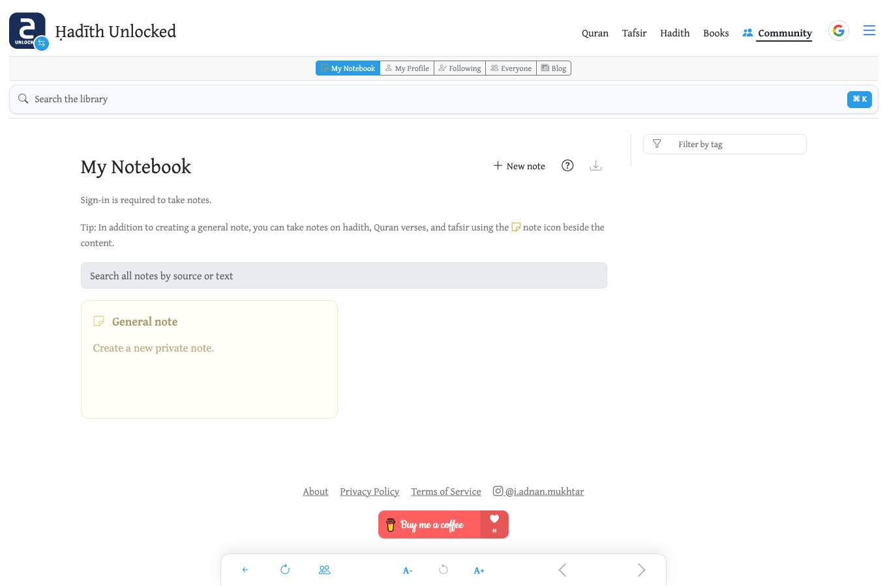
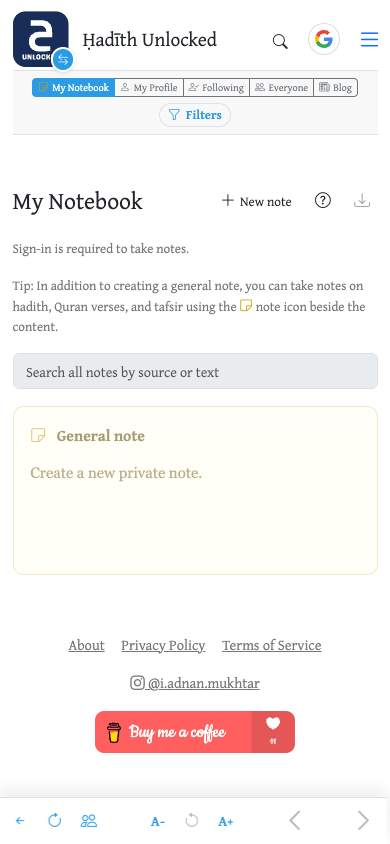

# Notebook, editing, sharing and export

My Notebook holds private Markdown notes and source-linked annotations. Readers can open the same material from a library item, a note link or the notebook navigator.

## Using the feature

| Function | What the reader sees and does | How it works |
| --- | --- | --- |
| Find or attach | The notebook provides search, tags and note navigation. A Note action on a reader opens a contextual editor with source information. | GET /api/notebook lists by query, tag and offset or retrieves one source key. Attachment lookup resolves an exact report or single ayah to an item identity. A detached older note is preserved when starting a new contextual note. |
| Write and preview | The editor offers formatted writing, Markdown, source expansion and internal note links. It can open expanded or floating beside a reader. | The editor keeps Markdown and front matter as the portable representation. Preview and expansion have separate endpoints. Floating preferences belong to the signed-in user. |
| Connect storage | A disconnected reader sees Connect Google Drive. Connected controls offer Import, Open folder and Disconnect. | Authorization binds the owner to a Drive identity. Active notes live as Markdown in the app folder. Migration verifies content before activation. Import registers selected files by Drive ID. |
| Save or remove | Failure and conflict feedback belongs to the active note. Removing an active note moves its file to Drive trash. | Writes check content revisions to avoid overwriting concurrent edits. Repeating an already-saved payload can reuse its revision. Source attachments, tags and custom front matter survive ordinary edits. |
| Share | Enable sharing to obtain a tokenized reader link. Recipients see a read-only note. Revoking the link removes that access. | The public reader resolves the token independently of the private editor. Missing/revoked notes return 404 and temporary storage failures return 503. The share response uses private, no-store caching. |
| Export and print | The editor can export a note as Markdown or print a formatted reading copy. Notebook download yields a ZIP. | POST download serializes supplied note content. GET download reads the owner’s notebook. The print client handles presentation separately from stored Markdown. |

## What each link opens

| Link or action | Identity and effect |
| --- | --- |
| Note on an ayah or report | Resolves the exact item and opens its associated private note. A Quran range must be attached one ayah at a time. |
| A wiki link inside a note | Resolves within the owner’s notebook. In the shared reader the label remains readable and private targets are removed. |
| An outline entry on a shared note | Moves to a heading on that page. The public renderer assigns unique IDs and accounts for bilingual parallel headings. |
| A sharing token | Reads the current Markdown from the original Drive file. The server checks that the token still exists after the read, so revocation during a request takes effect. |
| Import from Drive | Registers a selected existing Markdown file. Re-selecting that same file reuses its identity. Two distinct files can reference the same source. |

## Following a request

For a note on Bukhari 1, open Note on the report and save the text with its source attached. Reopen it through My Notebook, then use Share to obtain a reader link. Copying that note into a Community draft creates a separate publication workflow. Enabling an individual note link does not publish it to the feed.

## Earlier desktop and phone captures

These links open the archived route atlas. The URL identifies the original capture, including any redirect or gated state it encountered.

**Notebook overview before loading personal notes in the archived layout**

| Desktop | Phone |
| --- | --- |
|  |  |

| Screen | Requested URL | Desktop | Phone |
| --- | --- | --- |
| Notebook · signed out | `/notebook` | [Wide](../../design-system/screens/notes-wide.jpg) | [Narrow](../../design-system/screens/notes-small.jpg) |

## Implementation and related reading

- Notebook list, navigator and access states. [views/notebook.ejs](../../../views/notebook.ejs)
- Contextual editor and actions. [views/sub-views/notebook_modal.ejs](../../../views/sub-views/notebook_modal.ejs)
- Private list, attachments, previews, exports and sharing. [routes/notebook.js](../../../routes/notebook.js)
- Public token reader. [routes/notebook_shared.js](../../../routes/notebook_shared.js)
- File storage and concurrency. [lib/NotebookDrive.js](../../../lib/NotebookDrive.js)
- Formatted editing behavior. [public/static/js/notebook-rich-editor.js](../../../public/static/js/notebook-rich-editor.js)
- Print presentation. [public/static/js/notebook-print.js](../../../public/static/js/notebook-print.js)
- Identity, migration, conflicts and recovery. [docs/NOTEBOOK_GOOGLE_DRIVE.md](../../../docs/NOTEBOOK_GOOGLE_DRIVE.md)

Related guides · [Community writing, articles and blog](../publishing/README.md) · [Formatted writing and bilingual typography](../formatted-content/README.md) · [Account, sign-in and preferences](../accounts-settings/README.md)

[All features](../README.md)
