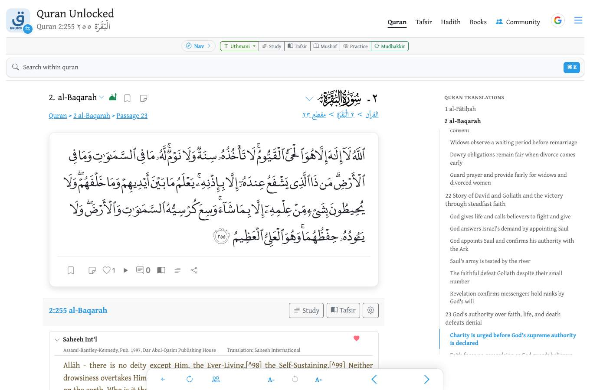
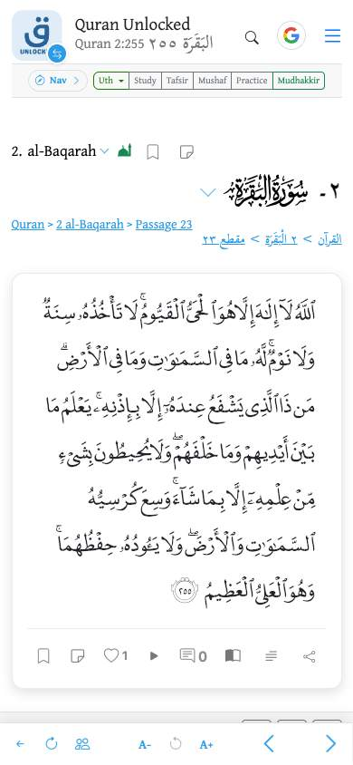

# Quran translation library and comparison

Read one translator continuously in Study or compare available translations for a single ayah.

## Using the feature

| Function | What the reader sees and does | How it works |
| --- | --- | --- |
| Choose a work | The translation catalog and Study picker identify works and authors. The chosen translation heads the Study column, above the surah title. | A public translation slug scopes the contents, divisions and verse routes. Aliases resolve through book metadata so the reader can retain the work across navigation. |
| Browse the work | Contents, introduction where available, Juz, Manzil and section links provide entry points. A subpassage can lead to its parent section. | The scoped handlers resolve the work, heading and surrounding section. Historical atlas entries include older 404s for chapter or introduction links. Availability depends on the current work and handler. |
| Read a range | An explicitly linked range keeps its start and end in the Study view. The work can be switched at the same location. | Both the scoped single-ayah route and the scoped range route use the translation passage handler. Exact reference bounds matter when sharing. |
| Compare renderings | Translations in the ayah dialog and the dedicated comparison page display the same Quran reference with available translated texts and attribution. | /quran/translations/quran:2:255 validates the surah and ayah, retrieves that ayah, and finds its section, outline and Mushaf page. Saved catalog preferences determine which works the reader enables. |

## Following a request

Use /quran/en-saheeh-intl/2/1 for a section in that work and /quran/translations/quran:2:255 to compare one ayah. These two reading tasks use different templates. Adding another translation to the comparison list does not change the boundaries of the ayah.

## Earlier desktop and phone captures

These links open the archived route atlas. The URL identifies the original capture, including any redirect or gated state it encountered.

**A single ayah opened in the translations reader in the archived layout**

| Desktop | Phone |
| --- | --- |
|  |  |

| Screen | Requested URL | Desktop | Phone |
| --- | --- | --- |
| Translation picker | `/quran/2/1` | [Wide](../../design-system/screens/translation-picker-wide.jpg) | [Narrow](../../design-system/screens/translation-picker-small.jpg) |
| Translation book contents | `/quran/en-saheeh-intl` | [Wide](../../design-system/screens/trans-book-wide.jpg) | [Narrow](../../design-system/screens/trans-book-small.jpg) |
| Translation surah entry · 404 | `/quran/en-saheeh-intl/2` | [Wide](../../design-system/screens/trans-chapter-wide.jpg) | [Narrow](../../design-system/screens/trans-chapter-small.jpg) |
| Translation introduction · 404 | `/quran/en-saheeh-intl/introduction` | [Wide](../../design-system/screens/trans-intro-wide.jpg) | [Narrow](../../design-system/screens/trans-intro-small.jpg) |
| Translation juz entry | `/quran/en-saheeh-intl/juz/1` | [Wide](../../design-system/screens/trans-juz-wide.jpg) | [Narrow](../../design-system/screens/trans-juz-small.jpg) |
| Translation manzil entry | `/quran/en-saheeh-intl/manzil/1` | [Wide](../../design-system/screens/trans-manzil-wide.jpg) | [Narrow](../../design-system/screens/trans-manzil-small.jpg) |
| Translation section | `/quran/en-saheeh-intl/2/1` | [Wide](../../design-system/screens/trans-section-wide.jpg) | [Narrow](../../design-system/screens/trans-section-small.jpg) |
| Translation subsection | `/quran/en-saheeh-intl/2/1/1` | [Wide](../../design-system/screens/trans-sub-wide.jpg) | [Narrow](../../design-system/screens/trans-sub-small.jpg) |
| Translation passage range | `/quran/en-saheeh-intl/quran:2:255-257` | [Wide](../../design-system/screens/trans-range-wide.jpg) | [Narrow](../../design-system/screens/trans-range-small.jpg) |
| Translations for one ayah | `/quran/translations/quran:2:255` | [Wide](../../design-system/screens/translation-wide.jpg) | [Narrow](../../design-system/screens/translation-small.jpg) |

## Implementation and related reading

- Translation-scoped Study and work contents. [routes/search.js](../../../routes/search.js)
- Canonical single-ayah comparison. [routes/translations.js](../../../routes/translations.js)
- Comparison page. [views/translation_passage.ejs](../../../views/translation_passage.ejs)
- Authored commentary introduction. [views/quran_commentary_introduction.ejs](../../../views/quran_commentary_introduction.ejs)
- Local translation book and study data. [lib/QuranStudyIndex.js](../../../lib/QuranStudyIndex.js)

[All features](../README.md)
