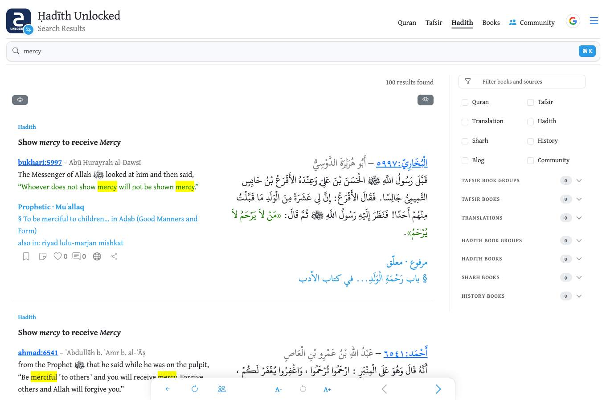
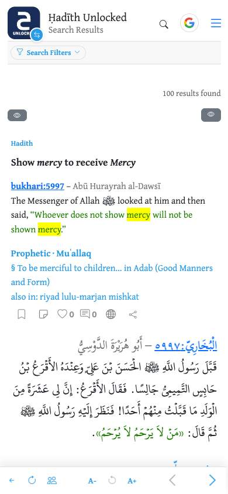

# Global search and results

Search the library from the masthead or open a results URL with a query. The selected scope determines the suggestions and destination.

## Using the feature

| Function | What the reader sees and does | How it works |
| --- | --- | --- |
| Start a search | The magnifier or keyboard shortcut opens a dialog with a scope picker and query field. Suggestions appear beneath the query. | The autocomplete handlers accept general and Quran requests. The search minimum counts three letters or digits after stripping diacritics. Changing scope with text already entered refreshes suggestions for that scope. |
| Choose a result or submit | A suggestion leads directly to its target. Entering a full query opens a page headed by the query, followed by result count, controls and excerpts. | The general route processes `/?q=…`. Quran searches enter through `/quran?q=…`. The results template selects partials for records, headings, articles and commentaries. |
| Refine | Applied book or tafsir filters appear as removable pills. Quran results expose sorting when the search supports it. | The route normalizes book and tafsir filters, builds display labels, and carries the query and sort into the response. |
| Read more or retry | Additional results append as the list grows. With zero matches the reader can edit the original search. | Appended records use the same result hierarchy. Empty-state recovery reopens the dialog with the query and the general or Quran scope, including on a direct visit. |

## Following a request

A book-title search inside the catalog only narrows that directory. For a phrase in a narration, open masthead search, choose the collection, submit the phrase, and follow the reference from the results. That final step changes the context from discovery to an identifiable source record.

## Earlier desktop and phone captures

These links open the archived route atlas. The URL identifies the original capture, including any redirect or gated state it encountered.

**Search results with highlighted matches in the archived layout**

| Desktop | Phone |
| --- | --- |
|  |  |

| Screen | Requested URL | Desktop | Phone |
| --- | --- | --- |
| Global search dialog | `/books` | [Wide](../../design-system/screens/command-wide.jpg) | [Narrow](../../design-system/screens/command-small.jpg) |
| Hadith search results | `/?q=mercy` | [Wide](../../design-system/screens/search-wide.jpg) | [Narrow](../../design-system/screens/search-small.jpg) |
| Quran search results | `/quran?q=mercy` | [Wide](../../design-system/screens/qsearch-wide.jpg) | [Narrow](../../design-system/screens/qsearch-small.jpg) |
| Empty search results | `/?q=xyzqzxqz` | [Wide](../../design-system/screens/empty-search-wide.jpg) | [Narrow](../../design-system/screens/empty-search-small.jpg) |

## Implementation and related reading

- Scope, query and suggestion controls. [views/sub-views/global_search_dialog.ejs](../../../views/sub-views/global_search_dialog.ejs)
- Autocomplete, filters, result dispatch and exports. [routes/search.js](../../../routes/search.js)
- Search query and result handling. [lib/Search.js](../../../lib/Search.js)
- Results, empty state and individual-record variants. [views/search.ejs](../../../views/search.ejs)
- Additional reader and result fragments. [lib/InfiniteScrollApiRoutes.js](../../../lib/InfiniteScrollApiRoutes.js)

[All features](../README.md)
