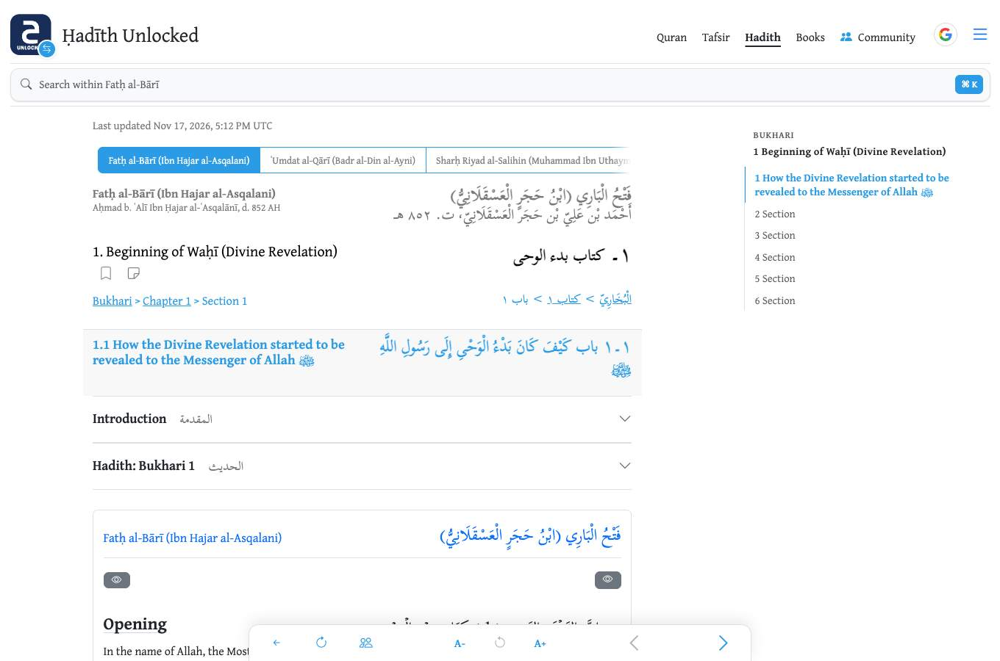

# Sharḥ collections and explanations

Sharḥ readers connect a commentary work to the headings and narrations it explains.

## Using the feature

| Function | What the reader sees and does | How it works |
| --- | --- | --- |
| Browse coverage | The Sharḥ catalog opens a book page. Its contents reflect the referenced hadith work, with tabs when the commentary covers multiple works. | The book route resolves the commentary alias and builds source outlines. Source-book context determines which chapter and section the breadcrumb returns to. |
| Open an explanation | The passage shows a compact source-hadith row and the explanation. Expanding the row reveals the narration, with its first Arabic line as the collapsed preview when available. | Numbered report entries resolve by work and reference. Heading explanations resolve through /sharh/:alias/heading/:id. Missing entries return 404. |
| Compare works | A picker offers other explanations for the current reference. When there is only one source the reader shows standalone metadata. | Available entries for this reference drive the picker. Identically titled works can be distinguished by author. Public passage HTML can use disk cache. Admin editing bypasses it. |

## Following a request

Open /sharh/bukhari-ibnhajar, follow an entry to /sharh/bukhari-ibnhajar/bukhari:1, and expand the narration for context. The reference anchors the hadith while the alias identifies the commentary. Either part can change the text a reader sees.

## Earlier desktop and phone captures

These links open the archived route atlas. The URL identifies the original capture, including any redirect or gated state it encountered.

**An explanation with its hadith and chapter context in the archived layout**

| Desktop | Phone |
| --- | --- |
|  |  |

| Screen | Requested URL | Desktop | Phone |
| --- | --- | --- |
| Sharh book and coverage | `/sharh/bukhari-ibnhajar` | [Wide](../../design-system/screens/sharh-book-wide.jpg) | [Narrow](../../design-system/screens/sharh-book-small.jpg) |
| Sharh on a hadith | `/sharh/bukhari-ibnhajar/bukhari:1` | [Wide](../../design-system/screens/sharh-wide.jpg) | [Narrow](../../design-system/screens/sharh-small.jpg) |

## Implementation and related reading

- Catalog redirect, source coverage and passage resolution. [routes/sharh.js](../../../routes/sharh.js)
- Source-book tabs and contents. [views/sharh_books.ejs](../../../views/sharh_books.ejs)
- Reading column, picker and source context. [views/sharh_passage.ejs](../../../views/sharh_passage.ejs)
- Entry and book retrieval. [lib/Sharh.js](../../../lib/Sharh.js)
- Commentary navigation. [lib/SharhNavigationIndex.js](../../../lib/SharhNavigationIndex.js)

[All features](../README.md)
