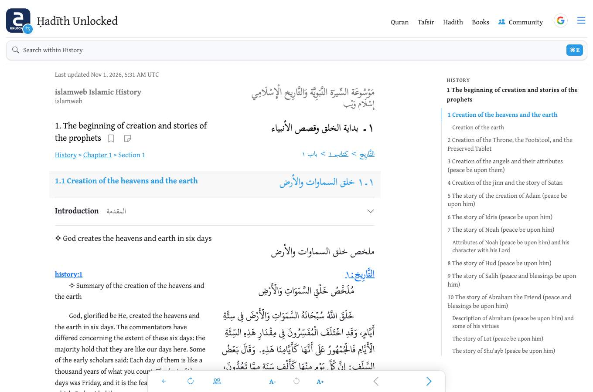

# History and Sirah

Historical works share the library’s bilingual navigation while presenting source passages as individually addressable reading items.

## Using the feature

| Function | What the reader sees and does | How it works |
| --- | --- | --- |
| Find a work | The History collection shows books and gives access to their metadata and contents. History and Sirah also appear on the home directory. | The catalog includes visible works of the Sirah book type. The alias identifies the individual historical source. |
| Read a passage | A topic title and source reference introduce the text. Language content and reader actions belong to that passage. The English and Arabic sides can have different amounts of text. | Colon links such as /history:1 or /yqsirah:1 resolve a specific item. The reader uses the Sirah passage and item templates for this material. |
| Continue in order | Chapter and section links take the reader through the work. Visible navigation can cross a chapter boundary. | SirahReader orders headings by ordinal and heading numbers. It includes level-two sections and includes a chapter itself when it has direct items or no sections. |
| Edit an item | In authorized edit mode editable fields appear in the reading context. | The shared item renderer retains the source item’s identity for saves and associated notes, bookmarks and reflections. |

## Following a request

Start with /books?history and choose an individual work. The contents describe the author’s organization. A passage permalink identifies one historical item even when the surrounding section contains several. Use its source link when sharing an event or biographical excerpt.

## Earlier desktop and phone captures

These links open the archived route atlas. The URL identifies the original capture, including any redirect or gated state it encountered.

**A history topic with surrounding chapter context in the archived layout**

| Desktop | Phone |
| --- | --- |
|  |  |

| Screen | Requested URL | Desktop | Phone |
| --- | --- | --- |
| History passage | `/history:1` | [Wide](../../design-system/screens/history-item-wide.jpg) | [Narrow](../../design-system/screens/history-item-small.jpg) |
| Sirah passage | `/yqsirah:1` | [Wide](../../design-system/screens/sirah-wide.jpg) | [Narrow](../../design-system/screens/sirah-small.jpg) |

## Implementation and related reading

- Adjacent heading selection. [lib/SirahReader.js](../../../lib/SirahReader.js)
- Reading page. [views/sirah_passage.ejs](../../../views/sirah_passage.ejs)
- Passage fields, editing and actions. [views/sub-views/sirah_item.ejs](../../../views/sub-views/sirah_item.ejs)
- Item resolution and canonical routes. [routes/search.js](../../../routes/search.js)

[All features](../README.md)
