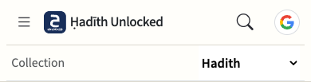

# Site navigation and public pages

Start here for the masthead, route-specific navigation, installation and recovery screens shared across the library.

## Using the feature

| Function | What the reader sees and does | How it works |
| --- | --- | --- |
| Navigate | The masthead offers Quran, Hadith, Books and Community. The menu drawer groups additional destinations. The account menu exposes actions for the current session. | The shared header selects the local navigation from the page context. The same URL can have extra editing actions when an authorized account enables edit mode. |
| Move within a work | The Quran modes or collection tabs sit below the global header. A contents drawer or rail marks the current location. Narrow layouts collapse long choices. | Global links change destination. The contents control resolves a location within the active book. The circular close action dismisses the overlay and returns focus to its trigger. |
| Install | The install action refers to Hadith, Quran, Notes or Mudhakkir according to the active page. | Each has its own manifest identity and start URL. Practice on a Mushaf page selects Mudhakkir. The origin-level service worker claims clients and leaves data caching to feature code. |
| Open About or legal pages | The footer provides access to background and legal text. The separate public slide document has its own presentation layout. | About and legal requests render application templates. Static HTML also serves the restart notice and the standalone slide deck. |
| Recover | Missing content opens a status page with a path back to the library. A restarting application has a dedicated waiting page. | Startup readiness is checked separately from the final Express missing-route and error handlers. The HTTP status distinguishes a missing reference from a temporarily unavailable application. |

## Following a request

Follow Books in the masthead, open a work, then open its contents control. The global destination stays Books or the relevant reader family, while local navigation now belongs to that work. The shared footer and persistent reader controls have distinct targets at the end of the page.

## Visual reference

Phone masthead with the compact navigation controls.

## How published pages appear outside the site

The browser title, social preview and structured page data draw on the same normalized title. Where a heading is missing, the identity helper can use opening words from the body. A source link retains the canonical reference, so sharing a titled passage does not require guessing its URL from the title. [Content identity](../../../lib/ContentIdentity.js)

Crawlers start at the sitemap index, which points to numbered URL lists and a separate updates sitemap. The Quran host has its own base URL. Community publication state is read separately from the cached corpus list so a newly public or withdrawn article can change discoverability. Signed-in settings and shared notes carry their own indexing directives. [Sitemap and page routes](../../../routes/search.js) · [Update sitemap](../../../lib/FreshnessSitemap.js)

## Earlier desktop and phone captures

These links open the archived route atlas. The URL identifies the original capture, including any redirect or gated state it encountered.

| Screen | Requested URL | Desktop | Phone |
| --- | --- | --- |
| Site navigation drawer | `/books` | [Wide](../../design-system/screens/menu-wide.jpg) | [Narrow](../../design-system/screens/menu-small.jpg) |
| About | `/about` | [Wide](../../design-system/screens/about-wide.jpg) | [Narrow](../../design-system/screens/about-small.jpg) |
| Terms | `/terms` | [Wide](../../design-system/screens/terms-wide.jpg) | [Narrow](../../design-system/screens/terms-small.jpg) |
| Privacy | `/html/privacy.html` | [Wide](../../design-system/screens/privacy-wide.jpg) | [Narrow](../../design-system/screens/privacy-small.jpg) |
| Service restarting | `/html/_app_restarting.html` | [Wide](../../design-system/screens/offline-wide.jpg) | [Narrow](../../design-system/screens/offline-small.jpg) |
| Page not found | `/error/404` | [Wide](../../design-system/screens/error-wide.jpg) | [Narrow](../../design-system/screens/error-small.jpg) |
| Standalone slideshow | `/html/masjidalhusna-slides.html` | [Wide](../../design-system/screens/public-slides-wide.jpg) | [Narrow](../../design-system/screens/public-slides-small.jpg) |

## Implementation and related reading

- Mount order, startup guard, manifests and error handling. [app.js](../../../app.js)
- Global navigation and page-specific includes. [views/sub-views/header.ejs](../../../views/sub-views/header.ejs)
- Footer destinations and contextual tools. [views/sub-views/footer.ejs](../../../views/sub-views/footer.ejs)
- Install identities and route selection. [lib/WebApps.js](../../../lib/WebApps.js)
- Worker lifecycle. [public/service-worker.js](../../../public/service-worker.js)
- Browser install flow. [public/static/js/web-app-install.js](../../../public/static/js/web-app-install.js)

[All features](../README.md)
