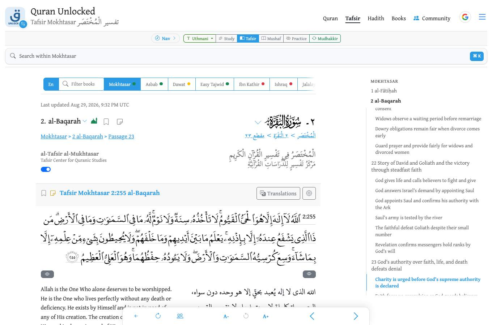
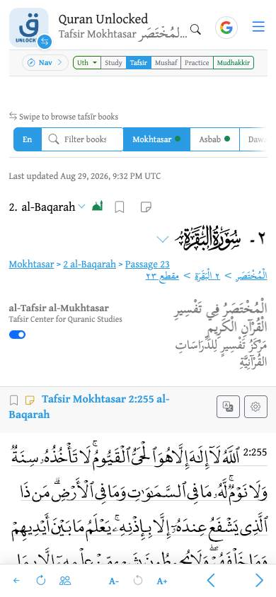

# Tafsir library and passage reading

A tafsir passage is an entry in a named work. Its author may explain one ayah or several together.

## Using the feature

| Function | What the reader sees and does | How it works |
| --- | --- | --- |
| Choose and browse | Book metadata and contents identify the commentary. Authored introductions link back to the same bilingual book heading. Division links enter the work at the relevant location. | The catalog resolves visible works, aliases and languages. Juz and Manzil handlers find the opening location and redirect into the chosen work. |
| Read a passage | The work picker precedes the surah heading. Arabic and available translations, sources and footnotes follow in the reading column. The ayah dialog also supports switching works. | The passage handler loads entries covering the requested ayah, finds their actual start and end, then derives the canonical URL for that work and range. |
| Keep focus across redirects | A full-page action leads from the dialog to the named tafsir. A verse inside a longer entry can remain selected while the page displays the complete entry. | The canonical redirect preserves an in-range focus in the ayah query parameter. The entry’s stored boundaries determine the citation URL. |
| Handle missing material | An unavailable source, invalid reference and failed retrieval can reach different error pages. | The handler validates verse bounds before retrieval. Out-of-range requests can return 416, an unknown tafsir can return 410, and an entry retrieval failure returns 503. |

## Following a request

When opening commentary on 2:255, inspect both the work name and the displayed range. If the selected work covers a longer passage, the visible text and canonical address expand to that entry. Switching to another work may produce different boundaries for the very same ayah.

## Earlier desktop and phone captures

These links open the archived route atlas. The URL identifies the original capture, including any redirect or gated state it encountered.

**Commentary organized around a Quran reference in the archived layout**

| Desktop | Phone |
| --- | --- |
|  |  |

| Screen | Requested URL | Desktop | Phone |
| --- | --- | --- |
| Tafsir book contents | `/quran/tafsir/mokhtasar` | [Wide](../../design-system/screens/tafsir-book-wide.jpg) | [Narrow](../../design-system/screens/tafsir-book-small.jpg) |
| Tafsir introduction | `/quran/tafsir/mokhtasar/introduction` | [Wide](../../design-system/screens/tafsir-intro-wide.jpg) | [Narrow](../../design-system/screens/tafsir-intro-small.jpg) |
| Tafsir surah entry | `/quran/tafsir/mokhtasar/2` | [Wide](../../design-system/screens/tafsir-surah-wide.jpg) | [Narrow](../../design-system/screens/tafsir-surah-small.jpg) |
| Tafsir juz entry | `/quran/tafsir/mokhtasar/juz/1` | [Wide](../../design-system/screens/tafsir-juz-wide.jpg) | [Narrow](../../design-system/screens/tafsir-juz-small.jpg) |
| Tafsir manzil entry | `/quran/tafsir/mokhtasar/manzil/1` | [Wide](../../design-system/screens/tafsir-manzil-wide.jpg) | [Narrow](../../design-system/screens/tafsir-manzil-small.jpg) |
| Tafsir subsection | `/quran/tafsir/mokhtasar/2/1/1` | [Wide](../../design-system/screens/tafsir-sub-wide.jpg) | [Narrow](../../design-system/screens/tafsir-sub-small.jpg) |
| Tafsir on an ayah | `/quran/tafsir/mokhtasar/2/255` | [Wide](../../design-system/screens/tafsir-wide.jpg) | [Narrow](../../design-system/screens/tafsir-small.jpg) |
| Tafsir on a range | `/quran/tafsir/mokhtasar/quran:2:255-257` | [Wide](../../design-system/screens/tafsir-range-wide.jpg) | [Narrow](../../design-system/screens/tafsir-range-small.jpg) |

## Implementation and related reading

- Aliases, divisions, canonical ranges and error handling. [routes/tafsir.js](../../../routes/tafsir.js)
- Catalog entry and export routes. [routes/tafsirs.js](../../../routes/tafsirs.js)
- Book resolution and entry lookup. [lib/Tafsir.js](../../../lib/Tafsir.js)
- Commentary reader. [views/tafsir_passage.ejs](../../../views/tafsir_passage.ejs)
- Catalog classifications. [docs/TAFSIR_CATEGORIES.md](../../../docs/TAFSIR_CATEGORIES.md)

[All features](../README.md)
